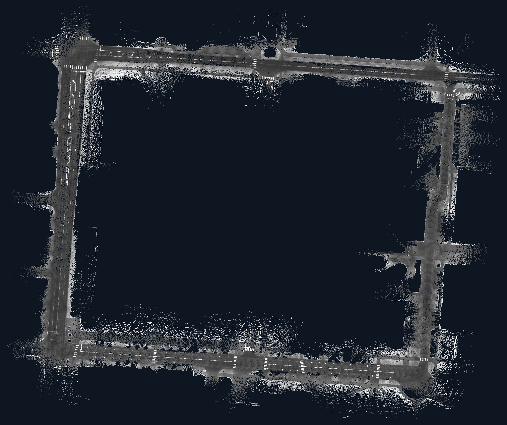

# BEV Map Annotator

**English** | [简体中文](./README.zh-CN.md)

A standalone **desktop BEV map annotation tool**. Build a ground-reflectivity map from consecutive point clouds, then annotate drivable areas, dividers, pedestrian crossings, road boundaries, and stop lines.

Current version: **v4.4 Mint**, with a mint-and-cream interface and a black map background by default. No browser, HTTP server, GPU, or PyTorch is required.

## Example BEV map

Ground-reflectivity map built from consecutive LiDAR point clouds. This is a top-down point-cloud projection, not a camera image.



## 1. Download and extract

Download the [v4.4 ZIP](./bev_map_annotator_desktop_v4_4_mint.zip) using the download button on its file page, then extract it.

Alternatively:

```bash
git clone https://github.com/TaozheLi/BEV-Map-Annotator.git
cd BEV-Map-Annotator
unzip bev_map_annotator_desktop_v4_4_mint.zip
cd bev_map_annotator_desktop
```

This repository contains the packaged application. Python source code, dependencies, and the example map are inside the ZIP.

## 2. Set up the environment

Verified with **Python 3.10.21 and Tk 8.6** on Linux. Dependencies include Pillow, Shapely, NumPy, and KISS-ICP; pinned versions are in the extracted `requirements.txt`.

### Linux / macOS

```bash
python3.10 -m venv .venv
source .venv/bin/activate
python -m pip install -r requirements.txt
python app.py
```

### Windows

Open a terminal in the extracted application directory:

```powershell
py -3.10 -m venv .venv
.venv\Scripts\python.exe -m pip install -r requirements.txt
.venv\Scripts\python.exe app.py
```

Installation and functional checks were performed on Linux. KISS-ICP installation on other platforms requires a compatible wheel or a local build environment.

### Check Tkinter

```bash
python -m tkinter
```

A test window should open. If Tkinter is missing, install Tk support for your Python version: for example, the matching `python3-tk` / `python3.10-tk` package on Ubuntu/Debian, or `tk` in Conda. Tkinter is a Python/system component rather than a regular pip dependency.

A graphical desktop is required. A plain SSH terminal cannot display the window directly.

## 3. Try the example map

```bash
python app.py
```

The application loads the bundled BEV image and 85 existing features. Select a feature, edit its vertices, and save.

Default annotation output:

```text
bev_map_annotator_desktop/saved/reviewed_annotations.geojson
```

The example source file is preserved. If the output already exists, the application loads your last saved annotations.

## 4. Build a map from your point clouds

### Option A: Desktop interface

1. Click **Point clouds** in the top bar.
2. Select the point-cloud root directory.
3. Keep **File pattern** as `**/*.pcd` to search subdirectories recursively; use `**/*.bin` for KITTI BIN.
4. Optionally enter **First frame / Last frame**; leave both empty to use all frames.
5. Defaults are **stride 10** and **0.15 meters/pixel**.
6. Leave the pose file empty to use **KISS-ICP** registration by default.
7. Leave **Output** empty to create a new output directory automatically.
8. Click **Build map and annotate**. When processing finishes, the new map opens for annotation.

Supported directory layouts include:

```text
root/
├── 01/
│   ├── 000001.pcd
│   └── 000002.pcd
└── 02/
    ├── 000001.pcd
    └── subfolder/
        └── 000002.pcd
```

Or:

```text
capture/
├── 000001/lidar.pcd
├── 000002/lidar.pcd
└── ...
```

Directories and filenames are naturally sorted, such as `01 → 02` and `2 → 10`. Duplicate filenames in different directories are distinguished by relative paths.

For example, enter these start/end frames:

```text
01/000001.pcd
02/000100.pcd
```

An ambiguous filename prompts you to provide its relative path.

### Option B: Command line

Use default KISS-ICP registration and automatic output:

```bash
python app.py --cloud-dir /data/root
```

Set a frame range and map sampling:

```bash
python app.py \
  --cloud-dir /data/root \
  --pattern '**/*.pcd' \
  --start 01/000001.pcd \
  --end 02/000100.pcd \
  --stride 10 \
  --resolution 0.15
```

Automatic registration processes **every frame** in the selected range. Stride controls map sampling only; it does not skip localization frames.

To use existing poses instead:

```bash
python app.py \
  --cloud-dir /data/root \
  --poses /data/poses.json \
  --map-output /data/new_bev_map
```

Example pose JSON:

```json
[
  {
    "frame": "000001",
    "T_world_from_lidar": [
      [1, 0, 0, 0],
      [0, 1, 0, 0],
      [0, 0, 1, 0],
      [0, 0, 0, 1]
    ]
  }
]
```

Each matrix transforms raw LiDAR coordinates into world coordinates. Poses must cover the selected frames. For duplicate point-cloud names, use relative frame IDs such as `01/000001`.

### Default output

When output is omitted, a new directory is created under the application directory:

```text
generated_maps/<input_name>_<timestamp>_<unique_suffix>/
├── ground_reflectivity.png
├── ground_map.npz
├── metadata.json
├── poses.json
├── annotations.geojson
└── reviewed_annotations.geojson   # Created when annotations are saved
```

Each build gets a separate directory. The status bar shows the actual path. If you specify output manually, use a new, empty directory.

### Point-cloud requirements

- Supports ASCII PCD, uncompressed binary PCD, and KITTI float32 XYZI BIN.
- `binary_compressed` PCD is currently unsupported.
- A `reflectivity` or `intensity` field is needed for the reflectivity map.
- Input must use meters and raw LiDAR coordinates with Z pointing upward.
- Current ground extraction assumes the ground is approximately 1.75 m below the sensor: candidate Z from −3.5 to −0.6 m, range 40 m, and near-horizontal RANSAC.
- Registration assumes the sorted clouds form a continuous recording. Build separate maps for disconnected recordings, or provide poses in a shared world frame.
- Matching `lidar_timing.npz` data and a PCD `column` field enable column-timestamp deskewing. Otherwise, per-point timing correction is unavailable.
- Inspect the map for drift or ghosting before annotating. Ground extraction does not automatically identify drivable areas.

## 5. Annotation classes

| Class | Geometry | Meaning |
|---|---|---|
| `drivable_area` | Polygon | Drivable area |
| `divider` | LineString | Road/lane divider markings |
| `ped_crossing` | Polygon | Entire pedestrian-crossing area |
| `boundary` | LineString | Road boundary |
| `stopline` | LineString | Stop line |

A stop line needs at least two points. For a pedestrian crossing, usually mark the four corners of the whole area rather than drawing individual white stripes.

## 6. Draw and edit

1. Select a class and click **New feature**.
2. Click vertices in boundary order.
3. Click **Finish drawing**; polygons close automatically.
4. Click **Save draft**.

Place polygon vertices clockwise or counterclockwise without self-intersections. Saving checks geometry validity and reports affected feature IDs.

| Action | Control |
|---|---|
| Select a feature | Feature dropdown on the left |
| Move a vertex | Drag a selected feature's vertex |
| Insert a vertex | Double-click an edge |
| Remove a vertex | Right-click a vertex |
| Delete a feature | Delete selected feature |
| Undo / redo | Undo / Redo or Ctrl+Z / Ctrl+Y |
| Cancel drawing | Cancel / Esc |
| Remove the last point while drawing | Backspace |
| Zoom | Mouse wheel or + / − |
| Fit the entire map | Fit map |
| Pan | Space+drag, middle-button drag, or enable Pan |
| Save | Save draft / Ctrl+S |
| Save to another file | Save as |
| Change font | Font… in the top bar; preview and save family/size |

Map rotation is currently unsupported. The default map background is black; enable **Light map** to change its appearance. Display settings do not modify the source image or annotation coordinates.

## 7. Open an existing BEV image

Click **Open map**, then choose an image, metadata JSON, optional initial GeoJSON, and an output file.

Or run:

```bash
python app.py \
  --image /data/map.png \
  --metadata /data/metadata.json \
  --annotations /data/initial.geojson \
  --output /data/saved/reviewed_annotations.geojson
```

For existing images, `--output` is a **GeoJSON file path**. For point-cloud builds, `--map-output` is a **map directory**.

Minimal metadata:

```json
{
  "coordinate_frame": "local_world_meters_not_WGS84",
  "resolution_m": 0.15,
  "minimum_world_xy": [-300.0, -120.0],
  "image_size": [2527, 2117]
}
```

Image right corresponds to world +X; image up corresponds to world +Y. `minimum_world_xy` is the outer bottom-left boundary in meters. Output coordinates are local metric coordinates, not latitude/longitude. Axis-aligned rasters with equal X/Y resolution are supported.

## 8. Saving and backups

- Edits are written only when you save.
- Before overwriting an existing output, its previous version is backed up in the adjacent `backups/` directory.
- The initial annotation file and output file must be different.
- If another editor changes the output, overwriting is blocked; use **Save as** to preserve your edits.
- `stopline` is supported in the desktop editor and GeoJSON output. Integrating it with a training framework still requires matching that framework's class definitions.

## 9. Optional: Verify the download

Place the ZIP and checksum file in the same directory:

```bash
sha256sum -c bev_map_annotator_desktop_v4_4_mint.zip.sha256
```

An `OK` result confirms the ZIP matches the uploaded version.

## 10. Tests

Run inside the extracted application directory:

```bash
python -m unittest discover -v
```

Desktop tests require an available display and are skipped when no display is available.
